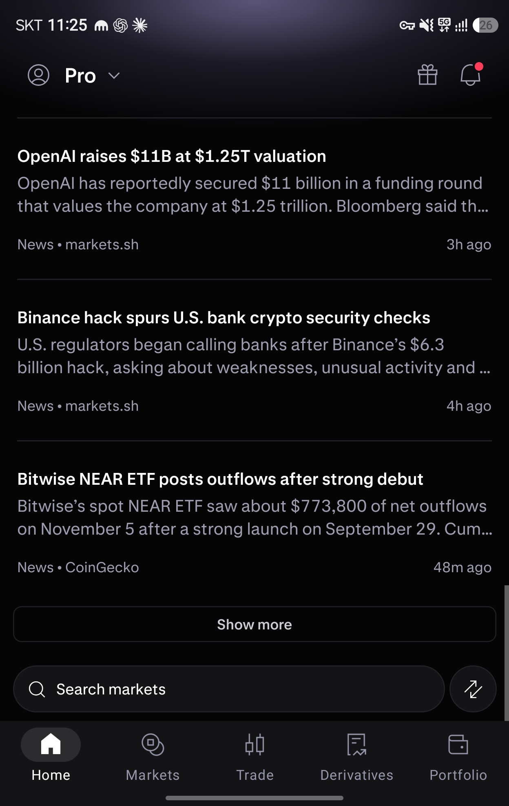
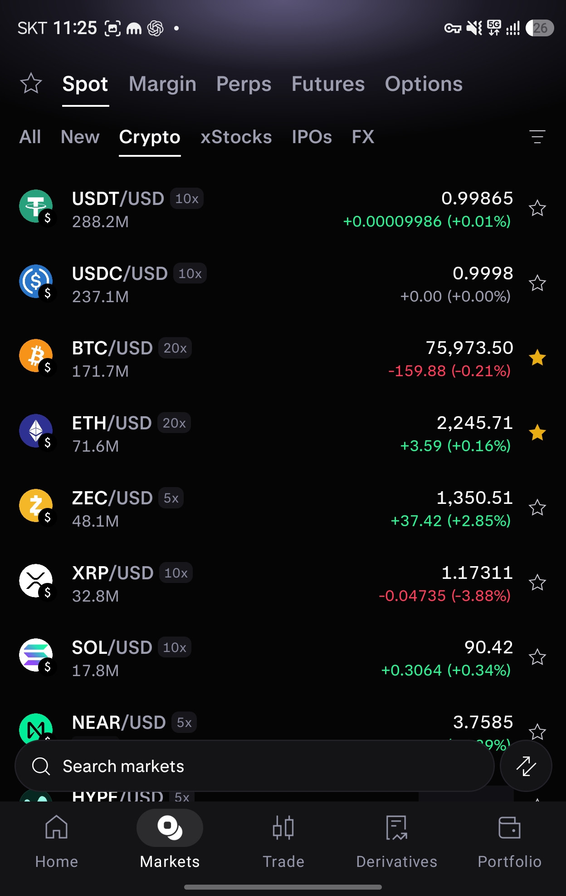
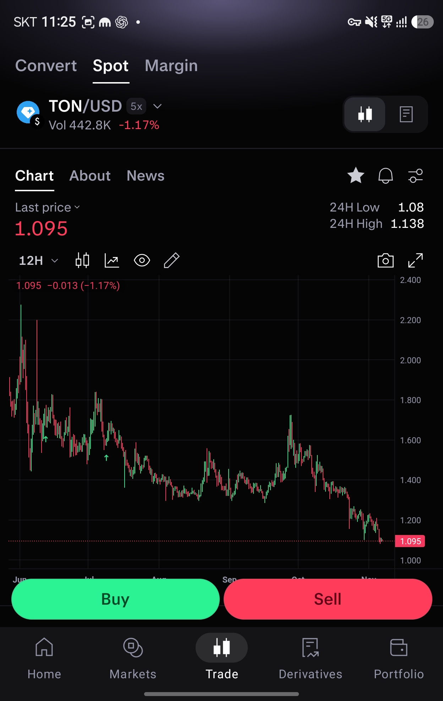
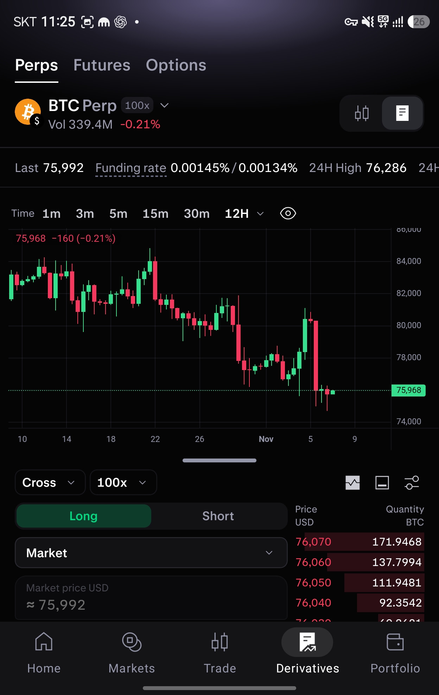
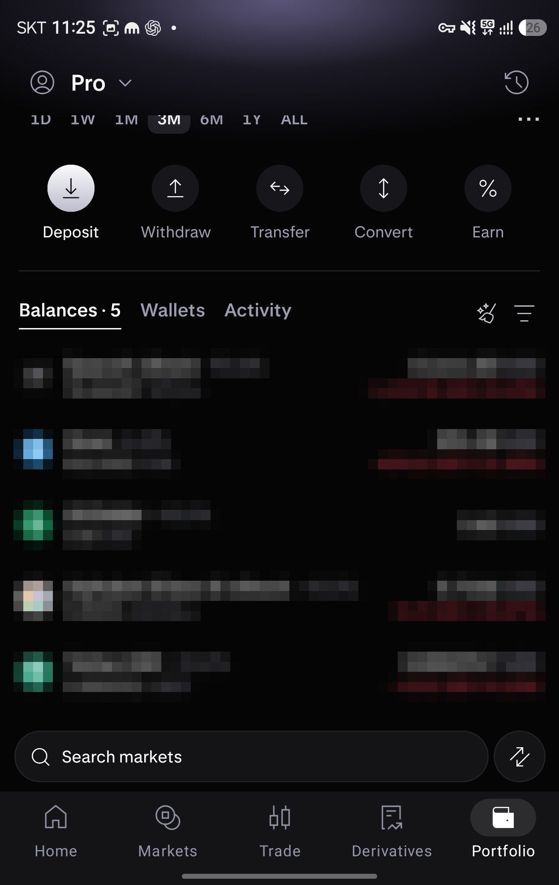

# Modern Mono UI 기술 명세

버전 1.0 · 작성일 2026-11-07 · 모바일 우선 · 디자인 및 프런트엔드 구현용

**의도:** 이전 「UI 톤앤매너 기술」의 다크 금융 UI 분석에 새 참고 이미지 5장을 통합해, 구현과 검수가 가능한 명세로 만든다.  
**동작:** 공통 토큰, 화면 구조, 컴포넌트, 상호작용, 데이터 표시, 접근성, 검수 기준을 정의한다.  
**판정:** 시각적 핵심은 **검은 바탕 + 타이포그래피 위계 + 정렬된 금융 데이터 + 의미 있는 색상**이다. 에디토리얼 화면과 거래 화면은 같은 바탕을 공유하지만 정보 밀도와 강조 방식은 달라야 한다.

이 문서는 특정 제품의 공식 디자인 시스템이나 소스 코드가 아니다. 참고 화면을 분석해 만든 독립적인 구현 명세이며, 실제 주문 API와 거래 기능은 구현하지 않는다. `modern-mono`의 mono는 무채색 중심의 UI를 뜻한다. 모든 글자를 고정폭 글꼴로 만드는 의미가 아니다.

## 1 적용 범위와 증거 수준

문서의 **관찰**은 이미지에서 직접 확인되는 내용이다. **권장 명세**는 재현성과 사용성을 위해 이 문서에서 결정한 구현값이다. **미확인**은 이미지와 이전 대화만으로 알 수 없는 항목이다. 별도 표시가 없는 CSS 수치, 상태 전이, 반응형 규칙, API 필드는 모두 권장 명세다.

### 1.1 참고 자료

| ID | 자료 | 직접 확인한 범위 | 반영 위치 |
|---|---|---|---|
| R0 | [이전 UI 톤앤매너 기술 대화](https://chatgpt.com/c/6aee8a1c-21f8-83e8-9546-aa97e697db68?messageId=deb0355e-ce3d-40ec-acec-9ac49a65d84f) | 검색에 노출된 Kraken Pro 분석 텍스트. 원래 첨부 이미지와 답변 전체 원문은 다시 열람되지 않음 | 디자인 원칙, 기존 분석 보완 |
| R1 | `2107.jpg` | Home 뉴스 목록, 상단 Pro 헤더, 검색, 하단 내비게이션 | 뉴스 행, 공통 앱 셸 |
| R2 | `2109.jpg` | Markets, 상품 및 자산 분류 탭, 시세 목록, 즐겨찾기 | 시장 행, 탭, 가격 변화 |
| R3 | `2111.jpg` | Trade의 Spot, TON/USD, 차트, Buy/Sell | 종목 헤더, 차트, 거래 액션 |
| R4 | `2113.jpg` | Derivatives의 Perps, BTC Perp, 지표, 차트, 주문 패널 일부 | 파생상품 레이아웃, 주문 입력, 호가 |
| R5 | `2115.jpg` | Portfolio, 기간 필터 일부, 자금 액션, 잔고 목록 | 퀵 액션, 보유 자산 행 |

새 이미지 5장은 모두 1248 × 1972 픽셀 JPEG다. 이 크기는 래스터 이미지 크기이며 CSS viewport, 기기 해상도 배율, Android dp를 확정하지 않는다. 아래 수치는 390~430 CSS px 폭에서 구현·검수할 시작값이다. 원본 픽셀을 1:1 CSS px로 사용하지 않는다.

기존 `modern-mono-design.md` 파일은 접근 가능한 파일 검색에서 확인되지 않았다. 따라서 이 문서는 기존 파일을 덮어쓴 버전이 아니라, 확인 가능한 이전 분석과 새 이미지의 통합본이다.

### 1.2 명확한 한계

- 원래 앱의 정확한 글꼴, 아이콘 세트, 공식 토큰, 애니메이션, 탭 전환 후 화면은 미확인이다.
- R3의 Chart와 R4의 차트/문서 모양 토글은 보이지만 토글이 정확히 무엇을 전환하는지는 미확인이다.
- R4의 주문 패널은 아래가 잘려 있다. 제출 버튼, 수량 입력 전체, 청산가, 주문 확인 화면을 관찰된 요소로 주장하지 않는다.
- R5의 상단 요약이나 포트폴리오 차트는 화면에 보이지 않는다. 기간 선택만으로 차트 형태나 전체 자산 계산을 추정하지 않는다.
- 이미지의 뉴스 제목, 시세, 수익률은 디자인 참고용 화면 내용이다. 최신 사실이나 금융 데이터로 검증한 것이 아니다.
- 잔고 이미지에는 개인 금융 정보가 포함될 수 있다. 공개 저장소나 외부 디자인 리뷰에 원본을 올리기 전 금액과 보유 내역을 가린 별도 자료가 필요하다.

## 2 기존 분석에서 유지할 것과 보완할 것

| 이전 분석의 방향 | 통합 명세 |
|---|---|
| Near-black, content-first, 절제된 무채색 | 유지. 기본 배경과 리스트는 검정에 가깝고 카드가 아니라 여백과 정렬로 구조를 만든다. |
| 시네마틱 이미지가 시각적 중심 | 이미지가 있는 에디토리얼 화면에 한정. 새 R1은 이미지 없는 뉴스 목록이며, R2~R5는 수치와 차트가 중심이다. |
| 녹색과 보라색을 작고 제한적으로 사용 | 보라색은 상단의 미세한 분위기 표현에 제한. 상승/하락, Buy/Sell처럼 의미가 있는 색상은 넓고 선명하게 써도 된다. |
| 중앙 제목과 뒤로가기 중심 내비게이션 | 상세 에디토리얼 페이지의 패턴일 수 있다. 새 화면의 공통 셸은 상단 기능 탭과 하단 5개 내비게이션으로 확장한다. |
| 넉넉한 단일 컬럼 | 뉴스와 자산 목록에는 유지. 파생상품은 차트 아래에 주문 입력과 호가를 병치해 정보 밀도를 높인다. |
| 보조 텍스트 `#898992`, 배경 `#050506` 등 | 공식값이 아닌 추정이라는 조건을 유지. 새 이미지의 반복 픽셀색을 참고해 아래 토큰을 구현 시작값으로 정한다. |

**설계상의 주의:** “미니멀”을 모든 컴포넌트의 강조를 없애는 것으로 해석하면 거래 방향과 활성 상태가 모호해진다. 반대로 모든 데이터를 카드로 감싸면 참고 화면의 개방감과 비교 가능성이 사라진다.

## 3 시각 원칙

1. **배경은 물러나고 데이터가 앞선다.** 페이지 본문에 큰 회색 카드, 떠 있는 그림자, 장식 그라데이션을 반복하지 않는다.
2. **같은 정보는 같은 위치에 둔다.** 종목명은 왼쪽, 가격·평가액은 오른쪽, 보조 지표는 바로 아래에 둔다.
3. **활성 상태는 형태로도 구분한다.** 상단 탭은 밝은 글자와 밑줄, 하단 내비게이션은 채워진 아이콘과 둥근 배경을 사용한다.
4. **색은 역할을 가진다.** 상승은 녹색, 하락은 빨강, 시장 목록의 즐겨찾기는 노랑, 일반 탐색과 상세 도구는 무채색이다. 로고의 원래 색은 허용한다.
5. **정보 밀도는 화면 목적에 맞춘다.** 뉴스는 읽는 리듬을, 시장은 빠른 비교를, 거래는 차트와 액션의 우선순위를 확보한다.
6. **실제 금액과 주문 상태는 장식보다 우선한다.** 중요 수치를 잘라 숨기거나 낙관적으로 주문 완료를 표시하지 않는다.

## 4 디자인 토큰

### 4.1 색상

JPEG의 압축, 안티앨리어싱, 화면 캡처 경로 때문에 표본 픽셀은 원본 디자인 토큰과 다를 수 있다. R1~R5에서 가장 흔한 픽셀은 `#050505`, 검색/하단 바의 넓은 면은 `#141416`이다. R3 버튼 내부에는 `#2BF393`와 `#FF3C5A`가 넓게 나타난다. 이 네 값만 래스터 측정에 근거하며 나머지는 시각적 근사와 구현 결정이다.

| 토큰 | 값 | 용도와 규칙 |
|---|---|---|
| `bg.canvas` | `#050505` | 앱 본문, 차트 배경 |
| `bg.surface` | `#141416` | 검색, 하단 내비게이션, 기본 입력 면 |
| `bg.surfaceSubtle` | `#101012` | 토글 트랙, 주문 패널 내부 |
| `bg.active` | `#2A2A2D` | 활성 내비게이션 캡슐, 선택된 토글 |
| `text.primary` | `#F5F5F7` | 제목, 가격, 선택된 메뉴 |
| `text.secondary` | `#9A99A7` | 설명, 단위, 거래량, 비활성 메뉴 |
| `text.tertiary` | `#7F7E8C` | 비필수 보조 정보. 작은 핵심 라벨에 사용 금지 |
| `border.subtle` | `#242428` | 장식적 구분선, 차트 그리드 |
| `border.control` | `#64646F` | 별도 경계가 필요한 입력/컨트롤의 접근성 대응 |
| `positive.text` | `#35DF97` | 상승 가격, 양수 변동 |
| `positive.fill` | `#2BF393` | Buy 주요 버튼 |
| `negative.text` | `#FF3C5A` | 하락 가격, 음수 변동 |
| `negative.fill` | `#FF3C5A` | Sell 주요 버튼 |
| `positive.tint` | `#103D2D` | Long 선택 배경 |
| `negative.tint` | `#321117` | 매도 호가 깊이 배경 |
| `favorite` | `#F4BB20` | 시장 목록에서 선택된 즐겨찾기 별 |
| `focus` | `#D3C7FF` | 키보드 포커스 표시 |
| `brand.glow` | `#655484` | 상단 장식의 원색. 낮은 불투명도로만 사용 |
| `text.onSemantic` | `#07120D` | 밝은 녹색/빨간색 버튼 위 글자 |

밝은 녹색·빨간색 CTA 위에는 어두운 글자를 사용한다. 상승/하락 숫자, Buy/Sell 텍스트와 `+`/`−` 부호는 색상과 함께 유지한다. 구분선의 낮은 대비는 장식적 영역에만 허용한다. 입력 여부를 경계선만으로 식별해야 한다면 `border.control`이나 명확한 라벨·형태를 사용하고 대비를 검수한다.

### 4.2 크기와 모양

| 토큰 | 권장값 | 적용 |
|---|---|---|
| 기본 spacing | 4, 8, 12, 16, 20, 24, 32 px | 임의의 마진 대신 공통 간격 |
| 페이지 좌우 여백 | 16 px | 360px 미만에서는 12px까지 축소 가능 |
| 최소 터치 영역 | 44 × 44 px | 작은 아이콘 주변에 투명 hit area 확보 |
| 시장/잔고 행 최소 높이 | 60 px | 긴 이름·큰 글자에서는 자연스럽게 늘림 |
| 기본 버튼 높이 | 44 px | 거래 CTA와 검색은 48px 권장 |
| 기본 아이콘 | 20 또는 24 px | 1.5~2px 일관된 선 굵기 |
| 자산 아이콘 | 28 px | 원형 슬롯, 원본 로고 비율 보존 |
| 작은 배지 radius | 6 px | 레버리지 배지 |
| 입력 radius | 10 px | 주문 유형 선택, 입력창 |
| 이미지 radius | 10 px | 에디토리얼 이미지가 있을 때만 |
| pill radius | 999 px | 검색, Buy/Sell, 활성 내비게이션 배경 |
| divider | 1 CSS px | 일관된 수평 구분선 |
| 탭 underline | 2 px | 글자 폭에 맞춘 활성 밑줄 |

### 4.3 글꼴과 수치

| 역할 | 크기 / 줄높이 | 굵기 | 정렬 |
|---|---|---|---|
| 상위 기능 탭 | 20 / 28 px | 600 | 왼쪽 |
| 섹션 탭 | 16 / 24 px | 600 | 왼쪽 |
| 종목 헤더 | 20 / 28 px | 600 | 왼쪽 |
| 대표 현재가 | 28 / 34 px | 500 | 왼쪽 |
| 뉴스 제목 | 16 / 22 px | 600 | 왼쪽 |
| 뉴스 설명 | 15 / 22 px | 400 | 왼쪽 |
| 시장/잔고 행 주요 정보 | 16 / 22 px | 500~600 | 이름 왼쪽, 값 오른쪽 |
| 행 보조 정보 | 13 / 18 px | 400 | 주 정보와 같은 기준선 |
| 차트 축과 호가 | 11~12 / 16 px | 400~500 | 수치는 오른쪽 |
| 하단 내비게이션 라벨 | 11 / 16 px | 500 | 가운데 |

권장 스택은 `Inter`, `Pretendard`, 시스템 sans-serif다. 정확한 원본 폰트라고 주장하지 않는다. 직접 호스팅하거나 적절한 라이선스가 확인된 글꼴만 사용한다. 표·가격에는 `font-variant-numeric: tabular-nums lining-nums`를 적용한다. 일반 본문에는 monospace를 적용하지 않는다.

## 5 공통 앱 구조

### 5.1 화면 계층

```text
AppShell
├─ Header / ProductTabs / InstrumentHeader   화면별 구성
├─ Main                                     주 스크롤 영역
│  ├─ SectionTabs / Summary
│  └─ Feed | MarketList | Chart | Portfolio | OrderPanel
└─ BottomDock                               콘텐츠 위로 겹치지 않는 예약 영역
   ├─ SearchDock | TradeActions | 없음       화면별 하나만
   └─ BottomNavigation                      Home / Markets / Trade / Derivatives / Portfolio
```

OS 상태 표시줄의 시간·배터리·통신 아이콘과 시스템 제스처 바는 앱 컴포넌트로 복제하지 않는다. 네이티브에서는 시스템 inset을 사용하고 웹에서는 safe-area를 고려한다.

### 5.2 하단 영역

- R1, R2, R5: 검색 pill + 우측 독립 원형 아이콘 + 5개 내비게이션. 우측 대각선 화살표 아이콘의 실제 기능은 미확인이므로 명세에서는 `secondaryAction` 슬롯으로 남긴다.
- R3: 같은 공간을 Buy/Sell 2열 버튼으로 교체한다. 전역 검색을 동시에 겹쳐 놓지 않는다.
- R4: 주문 패널이 본문에 이어지고 하단 내비게이션만 보인다. 검색이나 R3 CTA를 임의로 추가하지 않는다.
- BottomNavigation은 5등분한다. 아이콘은 위, 텍스트는 아래. 선택된 항목의 아이콘 뒤에만 둥근 어두운 캡슐을 놓는다.
- 활성 텍스트는 밝게, 비활성 텍스트와 선 아이콘은 회색으로 한다. 색만 바꾸지 말고 아이콘 fill과 배경을 함께 바꾼다.
- 본문이 하단 바 뒤에 가려지지 않도록 실제 dock 높이를 레이아웃에 반영한다. 확대 글꼴에서도 마지막 행을 끝까지 읽고 탭할 수 있어야 한다.

### 5.3 상단 분위기

참고 이미지 상단에는 아주 약한 보라색 빛이 보인다. 구현 시 header 뒤에만, 가운데에서 위로 퍼지는 얕은 radial gradient를 사용할 수 있다. 그라데이션을 본문 전체, 입력창, 차트 배경에 반복하지 않는다. 시세 가독성을 위해 차트 배경은 단색으로 유지한다.

## 6 컴포넌트 명세

### 6.1 UnderlineTabs

**관찰:** 상품 탭, Chart/About/News, Balances/Wallets/Activity 등에 반복된다.

- 항목 간 간격 20~24px. 활성 글자 `text.primary`, 나머지 `text.secondary`.
- 활성 밑줄은 텍스트 폭과 정렬하고 하단 6~8px 간격을 둔다.
- 한 줄로 수용되지 않으면 글자를 줄이지 말고 수평 스크롤한다. 활성 항목을 보이는 위치로 이동한다.
- 콘텐츠를 교체하는 탭은 `tablist`, `tab`, `tabpanel`, `aria-selected`를 사용한다. 다른 페이지로 이동하는 메뉴는 링크로 구현한다.
- 키보드는 좌우/Home/End 이동, Enter 또는 Space 활성화를 지원한다. 비동기 패널은 수동 활성화로 불필요한 로딩을 줄인다.

### 6.2 SegmentedControl

- 어두운 pill 트랙 안에 2개 옵션. 선택된 옵션만 채움 배경을 가진다.
- 중립 옵션은 `bg.active`; Long/Short처럼 방향을 선택하는 경우 녹색/빨간색 tint를 쓴다.
- 값, label, disabled, onChange를 받는다. 아이콘 전용이면 접근 가능한 이름을 필수로 지정한다.
- 상단 차트/문서 모양 토글의 제품 의미는 확인 후 연결한다. 아이콘 모양만 보고 주문 유형을 확정하지 않는다.

### 6.3 MarketRow

```text
[asset 28] [BASE / QUOTE] [leverage]       [last price] [star 44 hit]
           [volume]                      [change and percent]
```

- 자산 아이콘과 제목 사이 12px. Base는 밝게, `/QUOTE`는 회색, 레버리지는 작은 dark badge.
- 오른쪽 수치 영역은 고정폭 숫자로 오른쪽 정렬한다. 가격·변동의 너비 변화가 행 전체를 흔들지 않게 한다.
- 행은 카드나 구분선 없이 수직 간격으로 구분하는 것이 기본이다. 선택 행이 필요하면 낮은 대비 배경만 추가한다.
- 전체 행 이동과 즐겨찾기는 별도 상호작용으로 둔다. 버튼을 버튼 내부에 중첩하지 않는다.
- 즐겨찾기 on은 채워진 노랑 별, off는 회색 외곽 별. `aria-pressed`와 “BTC/USD 즐겨찾기 추가/해제” 같은 이름을 사용한다.
- 즐겨찾기 저장 실패 시 이전 상태로 되돌리고 짧은 오류 메시지를 제공한다.
- 노랑은 MarketRow 변형의 규칙이다. R3 상세 도구의 채워진 별은 흰색으로 보인다. 상세 변형은 중립색을 사용하되 on/off를 fill/outline으로 구분하도록 권장한다. 두 화면의 별이 실제로 같은 저장 상태를 공유하는지는 미확인이므로 제품 계약 확인 후 연결한다.

### 6.4 PortfolioRow

```text
[asset] [name · allocation %]                 [valuation CURRENCY]
        [quantity SYMBOL]                    [PnL amount (percent)]
```

- 이름과 평가액은 같은 첫 기준선에 둔다. 평가액의 통화 단위는 회색으로 낮춘다.
- 비중은 이름 다음에 보조 색상으로 표시한다. 길어지면 비중을 보조 줄로 이동한다.
- 수량과 ticker는 두 번째 줄. 수량 정밀도는 자산별 설정을 따른다.
- 이름은 최대 2줄까지 허용한다. 금액은 잘라내지 않는다. 폭이 부족하면 값 블록을 다음 줄로 이동한다.
- PnL이 없는 행은 0%를 만들어 넣지 않는다. 데이터 없음과 정확한 0을 구분한다.

### 6.5 NewsRow

- 제목 → 두 줄 요약 → 출처·시간의 순서. R1에는 썸네일이 없으므로 기본 변형에는 이미지 슬롯이 없다.
- 제목은 최대 2줄, 요약은 최대 2줄로 제한한다. 상세 화면에서 전체 내용을 볼 수 있어야 한다.
- 출처는 왼쪽, 상대 시간은 오른쪽. 둘 사이 최소 12px 여백.
- 행 사이에 `border.subtle` 구분선과 20~24px 상하 여백을 둔다.
- 기사로 이동하는 행은 링크로 구현한다. 출처명이 빈 경우 가짜 제공자 이름을 넣지 않는다.
- Show more는 outline full-width 버튼. 추가 로딩 중 폭과 높이를 유지하며 중복 요청을 막는다.

### 6.6 InstrumentHeader와 MetricStrip

- 종목 아이콘, base와 quote 또는 Perp, 레버리지 배지, 선택 chevron을 한 묶음으로 둔다.
- 다음 줄에 거래량과 변동률. 종목 변경 후 현재가·차트·주문 폼의 종목이 서로 다르게 남지 않아야 한다.
- R3은 현재가를 크게, 24H Low/High를 오른쪽의 작은 2행 목록으로 배치한다.
- R4는 Last, Funding rate, 24H High 같은 지표를 가로 스트립에 배치한다. 넘치는 지표는 스트립만 수평 스크롤한다.
- Funding rate처럼 설명이 필요한 지표는 터치/키보드로 열 수 있는 도움말을 제공한다. 점선 밑줄만으로 의미를 전달하지 않는다.
- R4의 Funding rate에는 두 값이 보이지만 각각 현재/예상 등 무엇을 뜻하는지는 미확인이다. 두 값의 의미, 산정 기간, 지급 주기와 기준 시각을 API 계약에서 확인하기 전 임의 라벨을 붙이지 않는다.

### 6.7 CandleChart

- 검정 배경, 얇은 저대비 그리드, 오른쪽 가격축, 아래 시간축, 녹색/빨간색 캔들.
- R3은 긴 기간의 작은 캔들이 촘촘한 구성, R4는 더 굵은 캔들과 짧은 날짜 범위다. 두 화면을 동일한 캔들 폭으로 고정하지 않는다.
- 마지막 가격의 수평 점선과 오른쪽 가격 배지를 표시한다. 차트 바깥 레이블이 잘리지 않도록 우측 축 공간을 예약한다.
- 현재 캔들 방향, 24시간 변동률, 마지막 체결 방향은 서로 다를 수 있다. 하나의 `isPositive` 값으로 모든 색상을 결정하지 않는다. R4도 음수 변동률과 녹색 마지막 가격 표식이 함께 보인다.
- interval은 캔들 집계 간격이다. `12H`를 “최근 12시간만 표시”라는 기간 필터로 오해하지 않는다.
- 툴바는 interval, 차트 표시/도구, 보기, 그리기, 캡처, 확장 같은 관찰된 아이콘 그룹을 담는다. 구체 기능이 없는 아이콘을 동작하는 척 배치하지 않는다.
- 드래그 crosshair는 시간, OHLC, 거래량을 표시한다. 확대·이동 중 페이지 스크롤과 충돌하지 않게 제스처 영역을 제한한다.
- 차트 미지원·접근성 환경을 위해 현재가와 최근 OHLC의 텍스트/표 대체 보기를 제공한다.
- 차트 라이브러리는 기존 제품 스택을 우선 재사용한다. 커스텀 캔버스 엔진을 새로 만드는 것을 기본값으로 삼지 않는다.

### 6.8 TradeActions

- 2열, 동일 너비, 간격 8px, 최소 높이 48px, pill 형태. Buy는 밝은 녹색, Sell은 빨강.
- label은 18px/600의 어두운 텍스트. 원본 의미를 유지해 매수/매도를 혼동하지 않게 한다.
- 버튼 클릭은 주문 입력을 시작하는 동작으로 설계한다. 즉시 실제 주문을 전송하는 버튼으로 연결하지 않는다.
- 데이터 stale, 거래 중지, 권한 없음에서는 비활성 사유를 노출한다. 색을 회색으로 바꾸는 것만으로 끝내지 않는다.

### 6.9 QuickAction

- 원형 아이콘 버튼과 아래 라벨. R5의 Deposit, Withdraw, Transfer, Convert, Earn 구조를 따른다.
- 원형 시각 크기는 40px, 실제 hit area는 최소 44px. 기본 배경은 dark surface.
- R5의 Deposit은 밝은 원으로 강조되어 있다. 이를 모든 액션에 복제하지 않는다.
- 5개를 한 줄에 넣기 어렵거나 글자 크기가 크면 줄바꿈 또는 가로 스크롤로 전환한다. 라벨을 극단적으로 축소하지 않는다.

### 6.10 OrderEntry와 OrderBook

**관찰된 R4:** 위쪽에 Cross/100x 선택, Long/Short 방향 선택, Market 유형, 시장가 표시 일부가 있고, 오른쪽에 Price USD/Quantity BTC와 붉은 호가 깊이 막대가 보인다.

**권장 명세:**

- 두 영역의 기본 비율은 2:1, gap 8px. 390px 미만 또는 큰 글꼴에서 주문 입력과 호가를 별도 탭/세로 영역으로 전환한다.
- 시장가에는 편집 불가능한 “예상 시장가”를 표시한다. 이를 사용자가 지정하는 limit 가격 필드처럼 보이게 하지 않는다.
- 호가 가격과 수량은 다른 열로 정렬한다. 깊이 막대는 행 배경이며 텍스트를 덮지 않는다.
- 각 호가 행은 실제 주문 API의 가격·수량 정밀도를 보존한다. UI의 표시용 반올림 값을 주문 값으로 재사용하지 않는다.
- Cross/레버리지 값 변경은 영향을 설명하는 선택 흐름으로 연결한다. 참고 화면의 100x를 제품 기본값으로 채택하지 않는다.
- 수량, 주문 검토, 제출, 성공/실패 화면은 R4에서 확인되지 않았다. 실제 거래 기능을 구현한다면 별도의 금융 기능 요구사항과 검증이 필요하다.

## 7 화면별 조립 규칙

### 7.1 Home 뉴스

**조립 순서:** Pro 헤더 → 상단 구분선 → NewsRow 반복 → Show more → 검색 dock → Home 활성 내비게이션.

- 프로필은 왼쪽, Pro와 dropdown은 그 옆, 선물/알림은 오른쪽에 위치한다. 알림의 미확인 개수는 숫자를 추정하지 말고 dot로만 표현한다.
- 뉴스 제목과 요약은 같은 왼쪽 경계에 맞춘다. 이전 분석의 시네마틱 이미지를 모든 뉴스 행에 추가하지 않는다.
- 콘텐츠가 길어도 검색 dock 위까지 마지막 버튼이 완전히 스크롤되어야 한다.
- 기사 이미지가 실제로 있는 별도 에디토리얼 변형에서만 본문 폭 이미지, 어두운 조명, 넓은 negative space를 사용한다.

### 7.2 Markets

**조립 순서:** 상품 탭 Spot/Margin/Perps/Futures/Options 및 관심 목록 진입 → 자산 분류 탭 → MarketRow 반복 → 검색 dock → Markets 활성 내비게이션.

- R2의 활성 상태는 Spot와 Crypto다. 필터 아이콘은 두 번째 탭 줄의 오른쪽에 둔다.
- 상품 변경과 자산 분류 변경을 다른 상태로 관리한다. 각 조합의 필터·정렬·스크롤 위치를 무분별하게 초기화하지 않는다.
- 즐겨찾기 항목과 비즐겨찾기 항목의 배경은 동일하다. 별 상태가 구분을 담당한다.
- 검색 화면의 구체 UI는 이미지에 없으므로 9장의 권장 상태 모델을 따른다.

### 7.3 Spot Trade

**조립 순서:** Convert/Spot/Margin → InstrumentHeader → 구분선 → Chart/About/News 및 도구 → 현재가 요약 → 차트 툴바 → CandleChart → Buy/Sell → Trade 활성 내비게이션.

- R3의 활성 상태는 Spot와 Chart다. 현재가와 음수 변동률이 모두 붉게 보인다. 현재가 색상을 결정하는 실제 기준은 미확인이다.
- 차트는 화면의 가장 큰 연속 영역이다. 차트 외곽을 별도 회색 카드로 감싸지 않는다.
- 모바일의 기본 차트 높이는 약 280~360px에서 시작하되, viewport와 글꼴 크기에 맞춰 조정한다. 작은 화면에서 모든 도구를 동시에 보이게 하려고 차트를 120px로 줄이지 않는다.
- About/News 내용은 미확인이다. 필요한 데이터를 연결한 후 해당 패널을 구현한다.

### 7.4 Derivatives

**조립 순서:** Perps/Futures/Options → InstrumentHeader → MetricStrip → 시간 간격 툴바 → CandleChart → 패널 분리 핸들 → OrderEntry + OrderBook → Derivatives 활성 내비게이션.

- R4의 활성 상품은 Perps, 종목은 BTC Perp다. 거래량·24시간 변화는 종목 바로 아래에 둔다.
- 차트 아래 짧은 가로 핸들은 패널 경계로 관찰된다. 실제 드래그 가능 여부는 미확인이다. 구현 시 드래그를 채택한다면 최소/최대 높이와 키보드 대체 컨트롤을 함께 제공한다.
- 주문 패널이 화면 아래로 이어지는 경우, 하단 내비게이션이 수량 입력·검토 액션을 가리지 않도록 전체 영역을 스크롤할 수 있게 한다.
- R4에서 보이지 않는 주문 실행 버튼을 스크린샷 재현의 필수 요소로 간주하지 않는다.

### 7.5 Portfolio

**조립 순서:** Pro 헤더와 활동/이력 아이콘 → 기간 필터가 보이는 영역 → QuickAction 5개 → 구분선 → Balances/Wallets/Activity → PortfolioRow 반복 → 검색 dock → Portfolio 활성 내비게이션.

- R5의 기간 필터는 3M, 섹션 탭은 Balances가 선택되어 있다. Balances에는 개수를 함께 표시한다.
- 잔고 이름과 비중은 왼쪽, 평가액과 손익은 오른쪽이다. 상단 요약이 없는 캡처를 근거로 총자산 헤더를 필수로 추가하지 않는다.
- 정렬/필터 및 추가 유틸리티 아이콘은 오른쪽에 둔다. 빗자루처럼 보이는 아이콘의 실제 기능은 미확인이다.
- 테스트 데이터는 합성 데이터를 사용한다. 첨부 이미지의 실잔고를 제품 기본 데이터나 스토리북 fixture로 복사하지 않는다.

## 8 숫자와 문구 규칙

- API 가격·수량은 decimal string으로 받는다. 금융 계산을 JavaScript 부동소수점 `Number` 덧셈·곱셈만으로 처리하지 않는다.
- 가격은 종목의 `pricePrecision`, 수량은 `quantityPrecision`, 표시 반올림은 별도 설정을 따른다. 모든 자산을 소수점 2자리로 고정하지 않는다.
- 등락은 양수 `+`, 음수 `−`, 정확한 0은 중립색과 `0.00%`. `-0.00%`가 생기지 않도록 표시 단계에서 처리한다.
- 양수/음수 판단은 문자열 첫 문자나 반올림된 표시값이 아닌 원본 수치로 판단한다.
- 손익 금액·변동률의 절댓값이 표시 정밀도보다 작으면 먼저 허용 범위 안에서 자릿수를 늘린다. 그래도 너무 작으면 `손실 <0.01 USD`, `하락 <0.01%`처럼 방향과 절댓값 상한을 함께 표시한다. 양수도 같은 방식으로 `이익`/`상승`을 사용한다. 작은 음수를 중립색 `0.00%`로 바꾸지 않으며, 접근 가능한 설명에는 원본 정밀도 값을 제공한다.
- `null`/미수신은 `—`. 0, 연결 오류, 값 없음은 다른 상태다.
- 매우 작은 비중은 `<0.1%`처럼 표현할 수 있다. 자산 수량이나 주문 가격을 이런 축약 문자열로 대체하지 않는다.
- `M`, `K` 축약은 거래량처럼 개요 수치에만 허용하고, 접근 가능한 전체 값을 제공한다.
- 가격·손익의 통화 단위와 기준 시간은 명확해야 한다. 24H 변화와 선택한 포트폴리오 기간의 손익을 섞지 않는다.
- relative time은 locale에 맞춰 “3시간 전” 등으로 표기하고 접근 가능한 absolute time을 제공한다.
- 실제 기능 언어는 제품 locale로 통일한다. 한 화면에서 Buy/매도, Home/포트폴리오가 무계획하게 섞이지 않게 한다.

## 9 상호작용과 상태

아래 동작은 정적 이미지에서 검증한 기능이 아니라 구현 권장값이다.

| 대상 | 기본 동작 | Loading / Empty / Error |
|---|---|---|
| 시장 검색 | 검색 입력으로 진입, 입력 250ms 뒤 검색, 이전 요청 취소 | 로딩 유지, 결과 없음과 오류 구분, retry 제공 |
| 탭 변경 | 선택값 변경 후 관련 패널 교체 | 레이아웃 높이 급변 최소화, 기존 데이터의 새 탭 오인 방지 |
| 즐겨찾기 | 별 및 접근성 상태 변경, 저장 | 실패 시 rollback, 토스트와 재시도 |
| Show more | 다음 cursor 로딩, 기존 목록 뒤에 append | 중복 id 제거, 끝이면 버튼 숨김/완료 문구, 실패면 기존 목록 유지 |
| 종목 변경 | quote·chart·order context를 같은 종목으로 갱신 | 종목 불일치 시 주문 비활성, 이전 종목 숫자 혼재 금지 |
| 가격 수신 | 변경된 수치만 갱신, 행 순서 고정 | 연결 끊김·지연 시 마지막 갱신 시간 표시 |
| 차트 interval | 선택 간격의 OHLC 조회 | skeleton/진행 상태, 빈 차트와 오류 구분 |
| Buy/Sell | 선택 방향의 입력/검토 흐름 진입 | 필수 데이터나 거래 가능 상태 미충족 시 이유와 함께 비활성 |
| 잔고 없음 | 잔고가 없다는 안내와 적절한 다음 액션 | 평가액 `0`과 fetch 실패를 구분 |

### 9.1 모션과 실시간 업데이트

- 탭 underline, 배경, 토스트는 120~180ms의 짧은 전환으로 충분하다. 가격 숫자 자체를 카운트업 애니메이션으로 지연시키지 않는다.
- `prefers-reduced-motion`에서는 장식 모션과 숫자 flash를 제거한다.
- 시장 목록의 시세는 렌더 갱신을 합쳐 처리하되 실제 수신 시각을 보존한다. 고빈도 가격 갱신으로 접근성 live region을 계속 읽게 하지 않는다.
- 차트 이동·확대는 프레임을 유지하도록 렌더 경로를 분리한다. 목록 스크롤 중 모든 행을 매 tick 다시 렌더하지 않는다.
- stale 기준은 상품별 데이터 계약으로 정한다. 예시 `staleAfterMs = 15000`은 서비스 SLA가 아니다. 미설정 상태로 거래 가능 여부를 임의 판단하지 않는다.

## 10 데이터와 컴포넌트 계약

프레임워크 중립적 예시다. 확정된 백엔드 API나 특정 상태 관리 라이브러리를 전제하지 않는다.

```ts
type DecimalString = string; // decimal library로 검증하고 계산한다.
type Trend = 'up' | 'down' | 'flat' | 'unknown';

interface Instrument {
  id: string;
  kind: 'spot' | 'margin' | 'perpetual' | 'future' | 'option';
  base: string;
  quote: string;
  displayName: string;
  iconUrl?: string;
  pricePrecision: number;
  quantityPrecision: number;
  leverageLabel?: string; // 표시값이며 거래 권한이나 기본 레버리지가 아니다.
}

interface Quote {
  instrumentId: string;
  lastPrice: DecimalString | null;
  change24h: DecimalString | null;
  changePercent24h: DecimalString | null;
  volume24h: DecimalString | null;
  low24h: DecimalString | null;
  high24h: DecimalString | null;
  lastTradeDirection: Trend; // 24시간 손익과 별개
  receivedAt: string; // ISO 8601
  marketState: 'open' | 'halted' | 'closed' | 'unknown';
}

interface Candle {
  openTime: string;
  open: DecimalString;
  high: DecimalString;
  low: DecimalString;
  close: DecimalString;
  volume: DecimalString | null;
}

interface MarketMetric {
  id: string;
  label: string;
  values: Array<{
    label: string; // 여러 값이면 각각의 의미를 확인한 명시적 라벨
    value: DecimalString | null;
    unit: string; // %, USD 등. 실제 데이터 계약에서 정한다.
    asOf: string; // ISO 8601 기준 시각
    period?: string; // 24h, 지급 주기 등. 모르면 추정하지 않는다.
  }>;
  helpText?: string;
}

interface PositionDisplay {
  assetId: string;
  quantity: DecimalString;
  valuation: DecimalString | null;
  valuationCurrency: string;
  allocationPercent: DecimalString | null;
  pnlAmount: DecimalString | null;
  pnlPercent: DecimalString | null;
  pnlPeriod: string;
}

interface NewsItem {
  id: string;
  title: string;
  summary: string;
  sourceName: string;
  publishedAt: string;
  url: string;
  imageUrl?: string; // text-only가 기본
}

type RemoteState<T> =
  | { status: 'loading' }
  | { status: 'ready'; data: T; updatedAt: string; stale: boolean }
  | { status: 'error'; message: string; previousData?: T };
```

### 10.1 컴포넌트별 최소 입력

| 컴포넌트 | 입력 | 이벤트 |
|---|---|---|
| `BottomNavigation` | items, activeRoute | onNavigate |
| `UnderlineTabs` | items, selectedValue, activationMode | onChange |
| `MarketRow` | instrument, quote, favorite | onOpen, onFavoriteChange |
| `PortfolioRow` | asset metadata, position display | onOpen |
| `NewsRow` | news item, locale | 링크 이동 |
| `SearchDock` | label, secondaryAction? | onSearchOpen |
| `MetricStrip` | MarketMetric[], locale | 도움말 열기 |
| `CandleChart` | instrument, candles, interval, liveQuote, connectionState | onIntervalChange, onRangeChange |
| `TradeActions` | allowedSides, disabledReason? | onStartOrder(side) |
| `OrderPanel` | instrument, side, type, marketStatus, draft | onDraftChange, onReview |

UI 상태와 서버 상태를 분리한다. 즐겨찾기는 사용자 상태, 탭·검색어·스크롤은 화면 상태, 가격·잔고는 서버 상태다. 시장 데이터가 갱신되었다고 사용자가 입력 중인 주문 초안을 덮어쓰지 않는다.

## 11 CSS 시작점

아래 코드는 공통 토큰과 레이아웃 출발점이다. 완성된 앱 코드가 아니며, 실제 프레임워크와 접근성 컴포넌트에 맞춰 연결한다.

```css
:root {
  color-scheme: dark;
  --bg: #050505;
  --surface: #141416;
  --surface-subtle: #101012;
  --active: #2a2a2d;
  --text: #f5f5f7;
  --muted: #9a99a7;
  --line: #242428;
  --control-line: #64646f;
  --up: #35df97;
  --down: #ff3c5a;
  --buy: #2bf393;
  --sell: #ff3c5a;
  --focus: #d3c7ff;
  --page-gutter: 16px;
}
* { box-sizing: border-box; }
body {
  margin: 0;
  color: var(--text);
  background: var(--bg);
  font-family: Inter, Pretendard, system-ui, sans-serif;
}
button, input, select { font: inherit; }
button, a { -webkit-tap-highlight-color: transparent; }
:focus-visible {
  outline: 2px solid var(--focus);
  outline-offset: 3px;
}
.app-shell {
  height: 100dvh;
  display: grid;
  grid-template-rows: auto minmax(0, 1fr) auto;
  overflow: hidden;
}
.app-main {
  min-width: 0;
  min-height: 0;
  overflow: auto;
  overscroll-behavior-y: contain;
  padding-inline: var(--page-gutter);
}
.bottom-dock {
  background: var(--bg);
  padding-bottom: env(safe-area-inset-bottom, 0px);
}
.bottom-nav {
  display: grid;
  grid-template-columns: repeat(5, minmax(0, 1fr));
  background: var(--surface);
  padding: 6px 4px 8px;
}
.bottom-nav a {
  min-width: 0;
  min-height: 56px;
  display: grid;
  justify-items: center;
  align-content: center;
  gap: 4px;
  color: var(--muted);
  text-decoration: none;
  font-size: 11px;
  line-height: 16px;
}
.bottom-nav a[aria-current="page"] { color: var(--text); }
.bottom-nav .icon-slot { padding: 4px 16px; border-radius: 999px; }
.bottom-nav a[aria-current="page"] .icon-slot { background: var(--active); }
.number { font-variant-numeric: tabular-nums lining-nums; }
.market-row {
  min-height: 60px;
  display: grid;
  grid-template-columns: 28px minmax(0, 1fr) auto 44px;
  align-items: center;
  column-gap: 8px;
  padding-block: 8px;
}
.market-row .numbers { text-align: right; white-space: nowrap; }
.icon-button { min-width: 44px; min-height: 44px; }
.trade-actions {
  display: grid;
  grid-template-columns: 1fr 1fr;
  gap: 8px;
  padding: 8px var(--page-gutter);
}
.trade-actions button {
  min-height: 48px;
  border: 0;
  border-radius: 999px;
  color: #07120d;
  font-size: 18px;
  font-weight: 600;
}
.buy { background: var(--buy); }
.sell { background: var(--sell); }
.positive { color: var(--up); }
.negative { color: var(--down); }
.order-workspace {
  display: grid;
  grid-template-columns: minmax(0, 2fr) minmax(0, 1fr);
  gap: 8px;
}
@media (max-width: 389px) {
  .order-workspace { grid-template-columns: 1fr; }
}
@media (prefers-reduced-motion: reduce) {
  .animated-state { transition: none; animation: none; }
}
```

시각적 글자 크기나 가변 데이터가 이 예시의 한 줄 레이아웃에 들어맞지 않으면 해당 행을 2단으로 재배치한다. 숫자를 잘라낸 채 예시 CSS를 유지하는 것은 명세 위반이다. sticky/fixed를 사용하는 대안 구현도 가능하지만, 중첩 스크롤과 하단 가림 현상을 동일하게 검수해야 한다.

## 12 반응형과 접근성

### 12.1 반응형

- **320~359px:** 좌우 12px, 행의 보조 정보를 다음 줄로 이동, 긴 가격 블록은 별도 줄. 기능 탭은 수평 스크롤.
- **360~767px:** 기본 모바일 구성. 390·416·430px에서 비교 검수한다.
- **768px 이상:** 원본 근거가 없는 확장 영역이다. 독립 모바일 뷰어는 중앙 폭 제한을 사용하고, 실제 웹 거래 화면이면 차트·주문·호가의 다열 구성을 별도 설계한다. 모바일 바를 단순 확대하지 않는다.
- 글자 크기 200%에서 내용이 겹치거나 금액이 잘리면 안 된다. 시장 행/잔고 행 높이는 고정하지 않는다.
- 키보드가 열린 주문 입력 화면에서는 현재 입력과 검토 액션이 보이도록 viewport와 스크롤을 조정한다. 키보드 위에 전역 검색을 중복 표시하지 않는다.

### 12.2 접근성

- 일반 텍스트 대비 4.5:1, 큰 텍스트 3:1을 목표로 검수한다. 의미 있는 컨트롤 경계·포커스·핵심 그래픽은 3:1을 검수한다.
- 위 토큰을 불투명 단색으로 계산하면 secondary/canvas는 약 7.27:1, control border/surface는 3.15:1, 어두운 CTA 글자/Buy는 13.02:1, 어두운 CTA 글자/Sell은 5.49:1이다. 실제 opacity·gradient·disabled 처리가 더해진 최종 화면은 다시 검사한다.
- 회색 secondary는 disabled가 아니다. 비활성 메뉴도 읽을 수 있는 대비를 유지한다.
- 색각 차이를 고려해 손익 부호, Buy/Sell 라벨, 선택 밑줄, fill 상태를 함께 제공한다.
- 모든 icon-only 버튼에 이름을 부여한다. 장식 로고는 중복 낭독하지 않는다.
- 차트의 캔들을 키보드로 탐색하거나 OHLC 표를 읽을 수 있게 한다. 캔버스 전체를 이름 없는 이미지로 두지 않는다.
- 모달/바텀시트는 focus trap, 닫기 버튼, Escape, 배경 비활성, 닫은 뒤 원래 트리거로 focus 복귀를 지원한다.
- 주문 결과는 명시적 상태 메시지로 알려준다. 가격 tick마다 screen reader를 방해하는 assertive 알림을 보내지 않는다.
- 뉴스 원문과 외부 링크는 목적을 설명하고, 새 창 이동이 있으면 예고한다.

## 13 구현 순서

1. **기초:** 색·타입·간격 토큰, 앱 셸, safe-area, 하단 내비게이션.
2. **재사용 행:** MarketRow, PortfolioRow, NewsRow, 숫자 formatter와 상태별 테스트.
3. **탐색:** 탭, 검색, 즐겨찾기, 뉴스 pagination, 포트폴리오 필터.
4. **시장 상세:** 종목 헤더, 지표, 차트 어댑터, interval과 stale 상태.
5. **거래 UI:** Buy/Sell 진입, 주문 초안, 방향·유형 선택, 호가 표시. 실제 주문 연결은 별도 검토.
6. **검수:** 5개 화면의 시각 비교, 큰 글꼴, 키보드, screen reader, 로딩·오류·재연결.

기존 UI 라이브러리가 있다면 Tabs, Dialog, Button, Tooltip의 동작과 접근성을 재사용하고 시각 토큰만 맞춘다. 참고 화면을 닮게 만들기 위해 이미 검증된 접근성 동작을 제거하지 않는다.

## 14 인수 기준

아래는 제품 구현 완료 시 통과해야 하는 체크리스트다. 이 문서 작성 단계에서 실제 앱 기능을 테스트했다는 뜻이 아니다.

### 14.1 공통 시각 검수

- [ ] 본문은 near-black이며 리스트마다 별도 회색 카드나 그림자를 추가하지 않았다.
- [ ] 5개 화면에서 동일 토큰, 여백, 텍스트 위계와 숫자 정렬을 사용한다.
- [ ] 활성 상단 탭의 밑줄과 하단 내비게이션의 캡슐/fill이 서로 다른 역할을 유지한다.
- [ ] 녹색/빨강은 가격 방향과 거래 방향에, 노랑은 시장 목록 즐겨찾기에 사용하며 상세 별 도구는 중립색 변형으로 구분한다.
- [ ] 마지막 행·버튼·호가가 하단 dock에 영구적으로 가려지지 않는다.
- [ ] 원본의 OS 상태 표시줄·제스처 바를 앱 UI로 복제하지 않았다.

### 14.2 화면별 시나리오

| ID | 시나리오 | 통과 조건 |
|---|---|---|
| V1 | Home 뉴스 3개 이상 표시 | 제목/2줄 요약/출처/시간/구분선/Show more/검색/Home 활성 구성이 유지된다. |
| V2 | Markets에서 상승·하락·0·미수신 종목 동시 표시 | 숫자 정렬이 안정적이고 색·부호·`—`가 각각 다르며 별 토글이 행 이동을 유발하지 않는다. |
| V3 | Spot에서 다른 종목과 interval 선택 | 헤더와 차트의 종목이 일치하고 12H는 캔들 간격으로 처리되며 Buy/Sell이 차트를 가리지 않는다. |
| V4 | Derivatives를 좁은 화면으로 표시 | 지표 스트립이 수평 스크롤되고 주문/호가가 안전하게 재배치되며 가격 열이 잘리지 않는다. |
| V5 | Portfolio에 긴 이름·미소 잔고·PnL 없는 자산 표시 | 금액이 완전하게 보이고 비중과 수량이 구분되며 손익 없는 행에 가짜 0%가 생기지 않는다. |
| V6 | 네트워크 끊김과 재연결 | 기존 데이터는 stale로 표시되고 retry 가능하며 이전 종목/계정 값이 새 맥락에 섞이지 않는다. |
| V7 | 200% 글자 확대와 키보드 탐색 | 가림/겹침이 없고 모든 동작에 focus와 이름이 있으며 금액을 확인할 수 있다. |
| V8 | 실제 주문 연결 전 단계 | 단순 Buy/Sell 선택으로 주문이 전송되지 않고 명시적 검토·제출 경계가 있다. |

### 14.3 문서와 원본 검증

- [x] 새 참고 이미지 5장을 직접 확인하고 각각의 화면 명세를 작성했다.
- [x] 이전 대화에서 회수 가능한 분석과 새 화면의 차이를 구분했다.
- [x] 공식값, 관찰값, 권장 구현값, 미확인 동작을 혼동하지 않게 표시했다.
- [x] 전체 이미지와 문서가 함께 있는 ZIP에서 상대 이미지 경로가 연결되도록 구성했다.
- [ ] 실제 제품의 viewport, 폰트, 데이터 API, 주문 정책, 공식 디자인 토큰은 별도 확인이 필요하다.

## 15 참고 이미지

단독 Markdown 파일의 본문은 바로 읽을 수 있다. 이미지도 함께 보려면 `modern-mono-design-reference.zip`을 풀고, 같은 폴더의 `modern-mono-design.md`를 Markdown 뷰어로 연다. 원본 이미지는 수정하지 않았다.

### R1 Home 뉴스 목록



### R2 Markets 시세 목록



### R3 Spot 차트와 거래 액션



### R4 Derivatives 차트와 주문 영역



### R5 Portfolio 잔고 목록



---

**한 문장 구현 지침:** 검은 바탕에 회색으로 구조를 낮추고, 흰 타이포그래피와 안정적인 숫자 정렬로 정보를 세우며, 거래 방향과 상태에만 강한 색을 사용한다.
